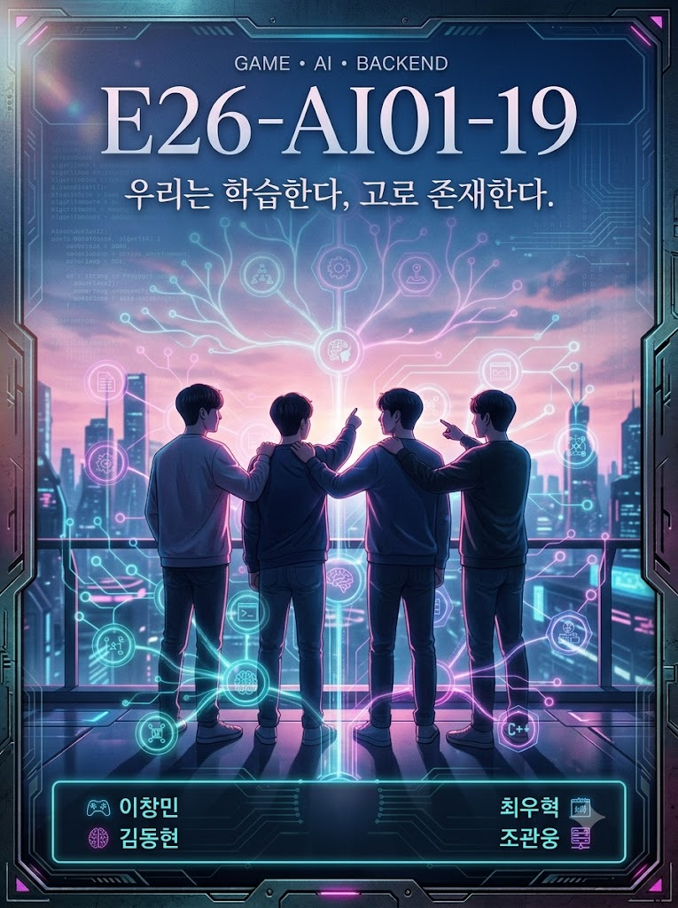
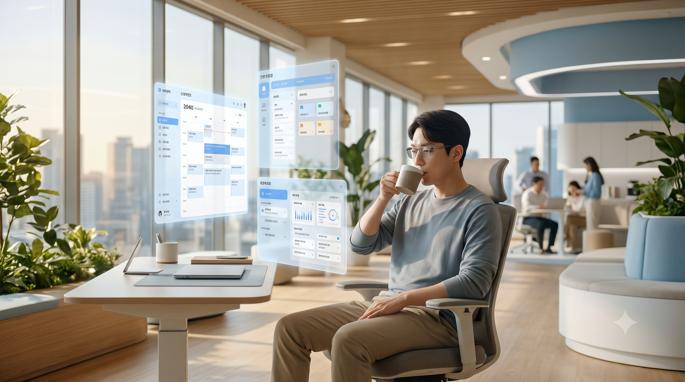

# Welcome to E26-AI01-19

## 🎯 팀 슬로건

> 우리는 학습한다, 고로 존재한다.
> (We learn, therefore we exist.)

데카르트의 명언을 AI 및 개발 관점으로 재해석하여, 멈추지 않는 지속적인 데이터 학습과 기술적 성장을 통해 존재 가치를 증명해 나가는 E26-AI01-19 팀입니다.

## 🖼️ 팀 포스터

<div class="poster"></div>

***

## 1️⃣ 팀원 소개

| **이름** | **전공** | **관심사** |
| --- | --- | --- |
| **이창민** | 인공지능전공 | 게임개발, 인공지능, 프론트엔드, 백엔드 |
| **김동현** | 인공지능전공 | 게임개발, 백엔드 |
| **최우혁** | 인공지능전공 | 백엔드. 인공지능 |
| **조관웅** | 인공지능전공 | 모바일 앱, 게임개발, 인공지능 |


### 팀 소개

**💡 팀 정체성 & 핵심 방향성**

우리는 AI 기술, 안정적인 백엔드 시스템, 그리고 몰입감 넘치는 게임 개발의 유기적인 결합을 지향합니다.

- **AI x Game**: 인공지능 알고리즘을 게임 로직 및 지능형 NPC/월드에 이식하여 한 차원 높은 게임 경험을 창조합니다.
- **Backend x Scale**: AI 모델과 게임 서버를 안정적이고 효율적으로 지탱하는 백엔드 아키텍처를 설계합니다.
- **Continuous Learning**: 끊임없이 변화하는 기술 트렌드 속에서 팀원 모두가 끊임없이 배우고(Train), 검증하며(Validate), 더 높은 성능(Optimize)을 향해 나아갑니다.

***

## 2️⃣ 공통된 관심사 : 게임, 인공지능, 백엔드

***

## 3️⃣ 한학기 동안의 활동 내역 

- 기관/부서 인터뷰 ✔️  

- 현장 탐방 ✔️  

- 멘토링 ✔️  
  - 내 지도 교수 함게 만나기
  - 대학원 방문 및 선배 만나기

- 프로젝트 진행 ✔️  
  - 과거에 사람들이 상상한 미래
  - 그들이 만들어가는 세상
  - 우리가 상상한 미래 (학식 실시간 대기·재고 확인 서비스)
  - 우리가 그리는 미래 그리고 나 (제로콜 Zero-Call: 2040년 자율형 앰비언트 AI 비서)

- 각오와 소감 나누기 ✔️  

#### 📌 과거에 사람들이 상상한 미래 — 미션 1

과거에 사람들이 상상했던 미래 기술이 현재 얼마나 실현되었는지 조사했습니다.

| 상상한 미래 | 실현 여부 | 설명 |
| --- | --- | --- |
| 달나라 여행 | 일부 실현 | 기술적으로 가능하나 비용이 너무 비쌈 |
| 로봇 청소 | 실현 | 이미 로봇청소기가 상용화되어 일상생활에서 사용 중 |
| 전기자동차 | 실현 | 테슬라 같은 전기자동차가 상용화되어 일상생활에서 사용 중 |
| 자율주행자동차 | 일부 실현 | 기술적으로 가능하나 법적으로 문제가 있음 |
| 소형 TV | 방향 전환 | 따로 소형 TV가 생긴 것이 아니라, 소형 컴퓨터인 스마트폰으로 다양한 것을 해결 |
| 집에서 치료 | 미실현 | 인프라도 구축이 안 되어 있고 기술적으로 아직 구현이 어려우며 법적으로도 문제가 있음 |

#### 📌 미션 2 — 자율주행자동차 심화 분석

위 조사 중 **자율주행자동차**를 주제로 선정하여 WHY-WHAT-HOW-NEXT 관점에서 더 깊이 분석했습니다.

- **WHY (왜 필요한가)**: 운전 피로감 해결, 안정성 향상, 편리성 증대
- **WHAT (무엇인가)**: AI가 자동차에 달린 카메라와 센서를 활용해 스스로 판단하고 운전하는 기술. 모든 자동차가 자율주행 자동차가 되는 것이 꿈꾸는 미래
- **HOW (어떻게 구현하는가)**: 주변 환경 인지 기술, 고정밀 측위 및 지도 기술, 상황 판단 및 경로 계획 기술, 주행 제어 기술, 통신 기술이 필요하며, 아직 법적·기타 문제로 인해 완벽한 자율주행은 구현되지 않음
- **NEXT (앞으로의 과제)**: 갑작스러운 변수에 대처할 수 있는 기술이 부족하고, 사고 발생 시 책임 소재를 가리는 법적 문제가 해결되어야 함

#### 📌 미션 3 — 우리가 상상한 미래: 학식 실시간 대기·재고 확인 서비스

학교생활 속 불편함에서 출발해, AI와 함께 문제를 정의하고 해결 방향을 도출했습니다.

**STEP 01. 문제 정의 (핵심 1문장)**

> 학생들은 점심시간에 학식당 줄이 얼마나 긴지, 먹으려는 메뉴가 남아있는지 직접 가보기 전에는 알 수 없어 대기 시간을 낭비하고 품절로 헛걸음을 한다.

**STEP 02. AI와 소통한 주요 프롬프트**

1. "대학교 학식당 이용자의 불편함을 사용자 입장에서 정리해줘."
2. "학식 줄 길이와 예상 대기시간을 온라인으로 보여주려면 어떤 데이터를 어떻게 모을 수 있을까?"
3. "메뉴별 남은 재고를 실시간으로 알려주는 방법을 비용이 적게 드는 순서로 제안해줘."
4. "학생들이 설치 없이 바로 쓸 수 있는 서비스 화면 구성을 제안해줘."

**STEP 03. AI 제안 내용 요약**

| 구분 | AI 제안 |
| --- | --- |
| 줄 길이 측정 | CCTV/카메라 인원 인식, 출입구 센서, 와이파이 접속자 수, 식권 키오스크 판매 데이터 |
| 예상 대기시간 | 대기 인원 × 1인당 평균 배식 시간으로 계산 |
| 메뉴 재고 | 준비 수량 − 키오스크 판매 수량으로 실시간 계산 |
| 전달 방식 | 모바일 앱, 웹페이지, 카카오톡 채널, 품절 임박 푸시 알림 |

**STEP 04. 팀의 수정 및 검토 내용**

- **카메라 방식 제외**: 개인정보 문제와 설치 비용을 고려해, 이미 존재하는 **키오스크 판매 데이터**를 활용하기로 결정
- **대기시간은 범위로 표시**: 정확한 분 단위 대신 "약 5~10분"처럼 보여주어 오차 부담을 줄임
- **재고는 3단계 상태로 표시**: 정확한 수량 대신 🟢여유 / 🟡임박 / 🔴품절로 직관적으로 표현
- **앱 대신 웹페이지**: 설치 없이 QR·링크로 바로 접속할 수 있도록 하여 이용 장벽을 낮춤

**STEP 05. 선택한 방향 및 다음 질문**

- **선택한 방향**: 키오스크 판매 데이터를 기반으로 식당별 예상 대기시간과 메뉴별 재고 상태(여유/임박/품절)를 보여주는 모바일 웹 서비스
- **다음 질문**
  - 학교·식당 운영 측으로부터 키오스크 데이터를 제공받을 수 있을까?
  - 키오스크 결제 없이 줄만 서 있는 인원은 어떻게 반영할까?
  - 실제 대기시간과 예측값의 차이를 어떻게 검증할까?

**OPTIONAL. 미래 서비스 콘셉트**

- 스마트폰 화면 상단: `한울식당 · 예상 대기 약 7분 · 대기 23명`
- 하단: 메뉴 카드 목록 (돈까스 🟢여유 / 제육덮밥 🟡임박 / 비빔밥 🔴품절)
- 품절 임박 메뉴에 "알림 받기" 버튼 제공

**🎤 사람이 결정한 부분은 무엇인가?**

> AI는 카메라 인식, 센서, 앱 등 다양한 방법을 제안했지만, **카메라 대신 키오스크 데이터를 쓰기로 한 것**, **정확한 수치 대신 범위와 3단계 상태로 보여주기로 한 것**, **앱이 아닌 웹으로 제공하기로 한 것**은 개인정보·비용·사용성을 고려해 팀이 직접 판단했습니다.

#### 📌 미션 4 — 우리가 그려보는 미래 I: 제로콜 (Zero-Call) 📵🤖

> **"부르기 전에 알아서 움직이는 2040년 완전 자율형 앰비언트(Ambient) AI 비서"**
>
> 2026 국민대학교 유레카 프로젝트 · Week 03 — 우리가 그려보는 미래 I

---

##### 🧩 Team Mission 1 — 미래 장면과 문제 선택

**1-1. 미래 문제 정의 (Sentence Frame)**

> 🎬 **핵심 장면:** 2040년 멀티태스킹에 지친 직장인의 **'지시 피로감(Prompt Fatigue)'** 해소

| 구분 | 내용 |
| --- | --- |
| 👤 **누가 (WHO)** | 일상생활과 복잡한 업무에서 동시에 보좌가 필요한 **30대 직장인**이 |
| 🕒 **언제·어디서 (WHEN/WHERE)** | 두 손이 묶여 있거나 고도로 집중해야 하는 **바쁜 업무 및 이동 중**일 때 |
| 😣 **무엇이 불편한가 (PAIN POINT)** | 도움을 받으려면 하던 일을 멈추고 일일이 앱을 켜서 상황을 설명하고 지시를 내려야 하는 번거로움 때문에 **업무와 일상의 흐름이 끊기는 것**이 불편하다. |
| ✨ **어떤 변화가 필요한가 (VISION)** | 사용자가 말하지 않아도 AI가 시선, 생체 신호, 주변 맥락을 파악해 불편함을 느끼는 순간 **스스로 판단하고 즉각 개입하여** 문제를 해결해 주는 서비스가 필요하다. |

**1-2. 주제 선정 평가 기준**

1. 💎 **사용자 가치 (User Value):** 프롬프트 입력 및 앱 실행에 드는 시간과 인지적 피로도를 **'0'**으로 줄여 본질적인 일에 집중하게 함.
2. 💡 **아이디어의 새로움 (Novelty):** 사용자가 호출(Call)해야만 작동하는 수동적 생성형 AI에서, 말 없이도 먼저 상황을 파악해 행동하는 **무언(Non-verbal) 선제적 자율 에이전트**로의 패러다임 전환.
3. 📚 **문제 정의의 근거 (Evidence):** 메신저/워크스페이스 연동 에이전트 및 학계의 **종단간(End-to-End) 자율 에이전트** 연구 성과를 통해 기술적 실현 가능성 입증.
4. 🚀 **향후 확장성 (Scalability):** 오피스 업무 보조를 넘어 스마트홈, 자율주행 모빌리티, 헬스케어 등 **일상 전 영역의 OS**로 확장 가능.

**1-3. 팀 내 역할 분담**

| 역할 | 담당자 | 주요 업무 |
| --- | --- | --- |
| 🧭 퍼실리테이터 | [이름 입력] | 논의 진행 및 시간 관리 |
| 👀 사용자 관찰자 | [이름 입력] | 사용자 입장에서 일상/업무 속 지시 피로감 및 페인포인트 검증 |
| 📝 기록자 | [이름 입력] | 최신 자율 에이전트 벤치마킹 근거 정리 및 결정 사항 기록 |
| 🎨 시각화 담당 | [이름 입력] | 미래 서비스 작동 장면 구체화 및 AI 이미지 생성 리드 |

---

##### 🛠️ Team Mission 2 — 미래 서비스 캔버스와 시각화

**2-1. 핵심 기능 (Core Features)**

1. 📲 **Zero-App 인터페이스:** 별도의 앱이나 웹을 실행할 필요 없이 일상 공간이나 기기 환경 어디서든 즉각 질문하거나 업무 지시 가능.
2. 👁️ **무언(Non-verbal) 상황 인지 및 선제적 개입:** 사용자의 말이나 명령이 없어도 표정, 시선, 화면 맥락 등을 통해 '불편함'이나 '필요'를 스스로 판단하여 자율적으로 솔루션 제시.
3. ⚙️ **End-to-End 자율 실행:** 단순 답변을 넘어 실제 메신저 조작, 파일 저장, 일정 조율, 반복 워크플로 최적화까지 스스로 완수.

**2-2. 미래 서비스 캔버스 (7가지 핵심 질문)**

| No. | 항목 | 내용 |
| :---: | --- | --- |
| 01 | 👤 **핵심 사용자 (User)** | 멀티태스킹 업무에 시달리는 직장인, 일상에서 세밀한 일정/정보 보좌가 필요한 사람 |
| 02 | 📍 **사용 상황 (Situation)** | 바쁜 업무 중이거나 이동 중이어서 일일이 앱을 켜고 검색하거나 AI에게 긴 프롬프트로 지시할 여유가 없는 상황 |
| 03 | 😣 **현재의 불편 (Pain)** | 클로드, 제미나이, 챗GPT 등 기존 AI는 사용자가 직접 앱을 켜서 질문하거나 하나하나 지시를 내려야만 수동적으로 작동함 |
| 04 | 🔄 **미래의 변화 (Change)** | 앱을 실행하거나 말을 하지 않아도, AI가 사용자의 불편함이나 필요한 순간을 스스로 판단해 선제적으로 해결책을 제시하고 업무를 대신 처리해 줌 |
| 05 | ✨ **핵심 경험 (Magic Moment)** | **"말하기 전에 이미 해결되어 있는 경험"** — 곤란한 상황을 마주한 순간, 질문조차 하지 않았는데 눈앞에 필요한 답변과 처리 완료 알림이 띄워지는 순간 |
| 06 | 🧠 **필요한 기술 (Tech)** | 자율 에이전트 워크플로(OS/메신저 직접 제어 및 자기 학습), 다중 에이전트 및 자가 치유(End-to-End 자율 실행 파이프라인), 맥락 인지(Context-Aware) 멀티모달 센서 |
| 07 | ⚠️ **남은 위험 (Risk)** | 자율성 윤리 및 통제 논란 (AI의 자율성이 높아지며 인간의 통제를 벗어나 예기치 못한 결정을 내리는 잠재적 위험 및 상시 관찰에 따른 프라이버시 침해 우려) |

**2-3. 기술 트렌드 및 벤치마킹 근거**

> 🚧 **현재 기술의 한계:** Claude, Gemini, ChatGPT 등 생성형 AI는 사용자가 직접 앱을 켜서 채팅/음성으로 전달해야만 답변하며, 필요한 상황을 자율적으로 판단해 직접 돕지 못함.

🔍 **유사 서비스 벤치마킹**

| 서비스 | 특징 | 연관성 |
| --- | --- | --- |
| `OpenClaw` | 서버에 설치해 메신저를 조작 화면으로 쓰는 대표적인 자율 에이전트의 원조 | 무중단 접근성 근거 |
| `Hermes Agent` | 수행한 작업 절차를 파일로 저장해 스스로 학습하고 반복 워크플로를 최적화하는 오픈소스 에이전트 | 자율 학습 근거 |
| `Gemini Spark` | 구글 워크스페이스(Gmail, Docs, Chrome 등)에 깊이 연동되어 클라우드에서 동작하는 자율 에이전트 | 워크스페이스 연동 근거 |

🧪 **최신 실험 및 연구 근거**

- **`오토 리서치 클로 (AutoResearchClaw)`**: 단 하나의 아이디어 입력만으로 23단계 파이프라인을 거쳐 NeurIPS 형식의 학술 논문을 자동 생성. 셀프 힐링(자기 치유), 다중 에이전트 토론, 4계층 인용 검증(무결성 94.3%) 탑재.
- **`사카나 AI 'AI 사이언티스트' (The AI Scientist)`**: 사카나 AI, 옥스퍼드대, 브리티시컬럼비아대 공동 개발 세계 최초 End-to-End 자율 과학 연구 AI 에이전트. 아이디어 구상 → 코드 작성 → 실험 → 자동 동료 검토(Peer Review)까지 수행 (논문 1편당 약 15달러 소요).
- **`스탠퍼드대 '가상 바이오기업 (Virtual Biotech)' 연구`**: 3만 7,000명의 가상 AI 연구원 조직이 폐암 및 궤양성 대장염 등 실제 임상 실패 데이터를 분석해 새로운 치료 전략과 바이오마커 조합 제시.

**2-4. 미래 장면 시각화 (Visualized Scene)**

<!-- 이미지 경로: ./assets/future_scene.png (저장소의 assets 폴더에 업로드된 이미지) -->
<p align="center">
  
</p>

> 🖼️ **장면 설명:** 2040년 스마트 오피스에서 30대 직장인이 스마트폰이나 키보드를 전혀 조작하지 않고 여유롭게 커피를 마시는 동안, 착용한 스마트 안경과 시선 너머의 반투명 홀로그램 UI가 사용자의 맥락을 읽고 스스로 일정을 조율하고 요약 문서를 띄워주는 장면.

🪄 **사용한 AI 프롬프트 기록**

```text
A futuristic smart office in 2040, a 30-year-old Korean office worker sitting comfortably drinking coffee without touching any smartphone or keyboard, wearing subtle smart glasses, transparent holographic UI floating gently in mid-air automatically organizing schedules and documents by reading the user's context, warm and bright natural lighting, soft blue and white tones, cinematic 3D rendering --no typing, holding smartphone, dark dystopian robot
```


<!-- 활동 사진 추가 예시 -->


***

## 4️⃣ 인상 깊은 활동

- 활동명 – 활동에 대한 간단한 설명과 배운 점을 작성  
- 예: 멘토링에서 실리콘밸리 현업 경험을 들을 수 있어 진로 방향 설정에 큰 도움이 되었다.  

***

## 5️⃣ 특별히 알아보고 싶은 것
- 예: 현장실습 제도
- 예: 학부 졸업 인증 조건
- 예: 성취기반평가
- 예: 졸업 후 진로(대학원/취업)

***

## 6️⃣ 활동을 마친 소감

🔗학번 이름  
> "소감 내용을 여기에 작성합니다."

🔗학번 이름  
> "소감 내용을 여기에 작성합니다."

🔗학번 이름  
> "소감 내용을 여기에 작성합니다."

🔗학번 이름  
> "소감 내용을 여기에 작성합니다."

🔗학번 이름  
> "소감 내용을 여기에 작성합니다."


## Markdown을 사용하여 내용꾸미기를 익히세요.

Markdown은 작문을 스타일링하기위한 가볍고 사용하기 쉬운 구문입니다. 여기에는 다음을위한 규칙이 포함됩니다.

```markdown
Syntax highlighted code block

# Header 1
## Header 2
### Header 3

- Bulleted
- List

1. Numbered
2. List

**Bold** and _Italic_ and `Code` text

[Link](url) and 
```

자세한 내용은 [GitHub Flavored Markdown](https://guides.github.com/features/mastering-markdown/).

### Support or Contact

readme 파일 생성에 추가적인 도움이 필요하면 [도움말](https://help.github.com/articles/about-readmes/) 이나 [contact support](https://github.com/contact) 을 이용하세요.

